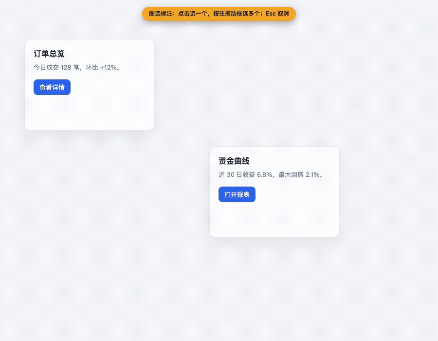

# dsh-browser-annotate

[](https://www.npmjs.com/package/dsh-browser-annotate)
[](https://www.npmjs.com/package/dsh-browser-annotate)
[](LICENSE)


在 DSH 右侧浏览器里**点选或拖框圈选**页面元素，把定位信息和修改意见直接发给当前会话的 AI。
特别适合「让 DSH 生成了一个 HTML，看着页面圈一下，让它改这一块」的工作流。



## English

Annotate elements in the DeepSeek Harness right-Sidebar browser (Desktop) and send the selection to the agent. Click a single element, or drag a marquee to select a whole region (a dialog, a card group, a toolbar). The message carries DOM paths, coordinates and text so the model can locate the source.

## 安装

```sh
dsh plugin --profile web add dsh-browser-annotate
```

重启 `dsh web` / 桌面端。仅支持 **Web / 桌面端** 的右侧浏览器；TUI 没有侧边栏，不适用。

## 用法

### 普通网页

1. 右侧栏打开 Browser 标签，加载任意网页；
2. 地址栏那一行末尾会出现**取景框图标**，点它进入圈选；
3. **单击**选一个元素；**按住鼠标拖一个框**，松手后框内区域成批选中；
4. 填写修改意见 → 「发送给 AI」。

### DSH 生成的 HTML（核心场景）

1. 在右侧「文档预览」打开 `.html` 文件；
2. 预览头部会出现同一个取景框图标，点它；
3. 插件用本机 loopback 服务把这个文件原样提供给 Browser，并**自动进入圈选**；
4. 圈选元素/区域 → 写意见 → 发送；改完刷新页面即可看到结果。

### 选择规则（简单版）

| 手势 | 结果 |
| --- | --- |
| 单击 | 命中的元素 |
| 按住拖动 | 框内元素成批选中；同一区域取**最外层**（例如整个弹窗，而不是里面的每个按钮） |

- 框住两张独立卡片 → 选中两个卡片；
- 框住一个弹窗 → 选中整个弹窗；
- 框住一排按钮 → 选中它们的共同容器，便于整体调整。

## 发送的消息

```
【浏览器圈选标注】
页面：http://127.0.0.1:...
用户框选了页面中的 2 个元素/区域，请把这些区域作为一个整体按修改意见调整：
- 元素 1：div#a
  路径：…
  页面坐标：…
  元素文本：…
- 用户的修改意见：…
```

单元素时保持同样的字段结构。

## 为什么仅桌面端

官方 Browser 在 Web 端是跨域 iframe，浏览器安全模型不允许读取内部 DOM；桌面端用 Electron `<webview>`，插件才能通过 `executeJavaScript` 注入标注层。Web 端点图标会提示「仅桌面端支持」。

## 兼容性

- DSH `>=0.2.2-rc.5 <0.4.0`；
- 依赖官方 Browser 的 webview DOM 标记 `webview[data-sidebar-browser-frame="webview"]`；上游若调整，需要跟进 `client.js` 的 `findBrowserWebview()`；
- 页面导航后需要重新进入标注模式。

## 隐私

标注内容只通过本机 Host 路由交给当前会话的 agent；不访问外部网络。HTML 预览使用仅监听 `127.0.0.1`、带随机 token 的临时文件服务。

## 开发

```sh
node --check index.js
node --check client.js
node scripts/preflight.mjs
```

## License

MIT
